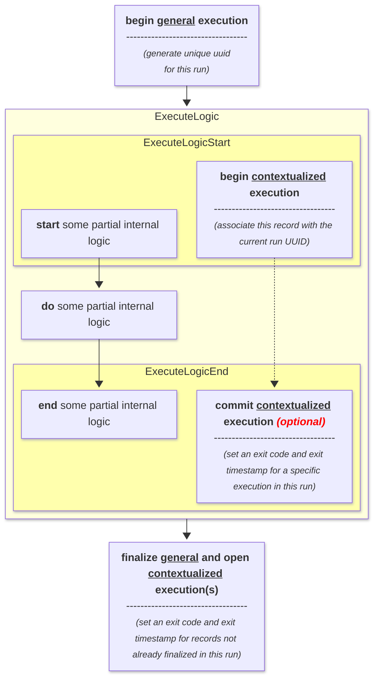

# HBM Basics - Execution Logger

Provides a generic way to log console command executions and enforce execution limits.

## Minimal setup

### Command
The command must extend `AbstractExtendableCommand`, implement
`ExecutionLoggerCommandInterface`, and use `ExecutionLoggerCommandTrait`. The trait
provides the interface hooks and requires you to provide an execution entity and its
repository. `AbstractExtendableCommand` also requires an `executeLogic()` method.

```php
<?php

namespace App\Command;

use App\Entity\CommandExecution;
use App\Repository\CommandExecutionRepository;
use HBM\BasicsBundle\Command\AbstractExtendableCommand;
use HBM\BasicsBundle\Command\Interfaces\ExecutionLoggerCommandInterface;
use HBM\BasicsBundle\Command\Traits\ExecutionLoggerCommandTrait;
use HBM\BasicsBundle\Entity\AbstractEntity;
use HBM\BasicsBundle\Entity\Interfaces\CommandExecutionInterface;
use Symfony\Component\Console\Command\Command;
use Symfony\Component\Console\Input\InputInterface;
use Symfony\Component\Console\Output\OutputInterface;

final class ExampleCommand extends AbstractExtendableCommand implements ExecutionLoggerCommandInterface
{
    private const string COMMAND_NAME = 'app:example';

    use ExecutionLoggerCommandTrait;

    public function __construct(private CommandExecutionRepository $commandExecutionRepository)
    {
        parent::__construct(self::COMMAND_NAME);
    }

    protected function executeLogic(InputInterface $input, OutputInterface $output): ?int
    {
        // Run the command's normal work here.
        return Command::SUCCESS;
    }

    protected function getCommandExecution(): AbstractEntity&CommandExecutionInterface
    {
        return new CommandExecution(self::COMMAND_NAME);
    }

    protected function getCommandExecutionRepository(): CommandExecutionRepository
    {
        return $this->commandExecutionRepository;
    }
}
```

### Entity

Create an entity implementing `CommandExecutionInterface`. `CommandExecutionTrait`
provides the execution fields and their accessors; `AbstractEntity` provides the
inherited ID, UUID, and timestamp fields.

```php
<?php

namespace App\Entity;

use HBM\BasicsBundle\Entity\AbstractEntity;
use HBM\BasicsBundle\Entity\Interfaces\CommandExecutionInterface;
use HBM\BasicsBundle\Entity\Traits\CommandExecutionTrait;

class CommandExecution extends AbstractEntity implements CommandExecutionInterface
{
    use CommandExecutionTrait;

    public function __construct(string $commandId, array $contexts = [], ?string $executionId = null, ?int $exitCode = null)
    {
        parent::__construct();
        $this->init($commandId, $contexts, $executionId, $exitCode);
    }
}
```

### Repository

The repository must extend `AbstractServiceEntityRepo` and pass the entity class to its
parent constructor. The trait uses this repository both to persist new rows and to query
and update them.

```php
<?php

namespace App\Repository;

use App\Entity\CommandExecution;
use Doctrine\Persistence\ManagerRegistry;
use HBM\BasicsBundle\Entity\Repository\AbstractServiceEntityRepo;

final class CommandExecutionRepository extends AbstractServiceEntityRepo
{
    public function __construct(ManagerRegistry $registry)
    {
        parent::__construct($registry, CommandExecution::class);
    }
}
```

### Doctrine mapping

The entity needs a Doctrine mapping for the properties declared by both the traits and
`AbstractEntity`. This XML example maps those properties and enables the timestamp
lifecycle callback. Save it as
`config/doctrine/App.Entity.CommandExecution.dcm.xml` in the host application:

```xml
<?xml version="1.0" encoding="UTF-8"?>
<doctrine-mapping xmlns="http://doctrine-project.org/schemas/orm/doctrine-mapping"
    xmlns:xsi="http://www.w3.org/2001/XMLSchema-instance"
    xsi:schemaLocation="http://doctrine-project.org/schemas/orm/doctrine-mapping https://www.doctrine-project.org/schemas/orm/doctrine-mapping.xsd">
    <entity name="App\Entity\CommandExecution" table="command_execution" repository-class="App\Repository\CommandExecutionRepository">
        <id name="id" type="integer">
            <generator strategy="AUTO"/>
        </id>
        <field name="uuid" type="string" length="64" unique="true"/>
        <field name="created" type="datetime" nullable="true"/>
        <field name="modified" type="datetime" nullable="true"/>
        <field name="executionId" column="execution_id" type="string" length="36"/>
        <field name="commandId" column="command_id" type="string" length="255"/>
        <field name="contexts" type="json"/>
        <field name="exitCode" column="exit_code" type="integer" nullable="true"/>
        <field name="exited" type="datetime" nullable="true"/>
        <lifecycle-callbacks>
            <lifecycle-callback type="prePersist" method="updateTimestamps"/>
            <lifecycle-callback type="preUpdate" method="updateTimestamps"/>
        </lifecycle-callbacks>
    </entity>
</doctrine-mapping>
```

With this setup,
executions are logged; no limits are applied until `getExecutionLimits()` is overridden.

## Options
Override `isExecutionLogged` to generally enable/disable the logging.  
Override `getExecutionLimits` to define the execution limits.

### Output/messages
Feel free to override the following properties to adjust the output message **text**...
- `$commandExecutionMessageLimitReached`
- `$commandExecutionMessageLimitReachedInterval`
- `$commandExecutionMessageExecuted`  

... and **verbosity**:
- `$commandExecutionVerbosityLimitReached` (default: `OutputInterface::VERBOSITY_NORMAL`)
- `$commandExecutionVerbosityExecuted` (default: `OutputInterface::VERBOSITY_VERBOSE`)

### Examples:
```txt
WARNING: Command execution limit reached: 2/2 (Interval: PT15M)
1 command execution(s) marked as executed.
```

## Execution limits
You can provide a single maximum as an integer or a list of `CommandExecutionLimit`
objects. Every limit in a list must pass; reaching any one of them prevents the
execution. Each limit counts up to its maximum within the optional interval and can
filter by exit code:

- An integer exit code counts executions with that exact code.
- `true` (the default) counts executions with any non-null exit code.
- `false` counts executions with no exit code, such as unfinished records.

Consequently, a plain integer limit counts completed executions only. If unfinished
records should also count, add a separate limit with `exitCode: false`. If any configured
limit is reached before a general execution is logged, the command's logic is skipped and
the command returns `Command::INVALID`.

### Examples
#### Most basic limit
Allow at most one completed execution in total.
```php
protected function getExecutionLimits(): array|int
{
    return 1;
}
```

#### Simple (interval based) execution limit
Allow at most one completed execution in each 15-minute interval.
```php
use HBM\BasicsBundle\Util\CommandExecutionLimit;

protected function getExecutionLimits(): array|int
{
    return [new CommandExecutionLimit(1, new \DateInterval('PT15M'))];
}
```

#### Complex (interval and exit code based) execution limit
The command should only be executed:
- if fewer than **one completed execution exists in the last 15 minutes**;
- if fewer than **four completed executions exist in the last day**;
- if fewer than **two unfinished executions exist in the last two hours**; and
- if fewer than **one failure execution exists**.

```php
use HBM\BasicsBundle\Util\CommandExecutionLimit;
use Symfony\Component\Console\Command\Command;

protected function getExecutionLimits(): array|int
{
    return [
        new CommandExecutionLimit(1, new \DateInterval('PT15M')),
        new CommandExecutionLimit(4, new \DateInterval('P1D')),
        new CommandExecutionLimit(2, new \DateInterval('PT2H'), exitCode: false),
        new CommandExecutionLimit(1, exitCode: Command::FAILURE),
    ];
}
```

## Contextualized execution
In addition to the command's general execution record, a command can log individual
contextualized executions—for example, one for each entity handled in a loop. Contexts
are stored in the `contexts` JSON field. Objects that provide `getIdFQCN()` are recorded
as their entity identifier; other context values must be JSON-serializable.

Call `checkAndLogExecution()` before processing each item. It returns `null` when the
item's limit is reached; otherwise it returns the persisted execution record. Commit
each record when its work finishes, or leave it open to let the normal post-execution
hook finalize it with the command's overall exit code.
```php
use HBM\BasicsBundle\Util\CommandExecutionLimit;
use Symfony\Component\Console\Command\Command;

$commandExecutionLimits = 3;
// or
$commandExecutionLimits = [
    // Count all completed executions, regardless of exit code.
    new CommandExecutionLimit(2, new \DateInterval('PT15M'), true),
    // Count unfinished executions with no exit code.
    new CommandExecutionLimit(5, new \DateInterval('PT2H'), false),
    // Count executions with a successful exit code.
    new CommandExecutionLimit(15, new \DateInterval('P1D'), Command::SUCCESS)
];

foreach ($items as $item) {
    foreach ($someOtherOptions as $option) {
        if (!$commandExecution = $this->checkAndLogExecution([$item, $option], $commandExecutionLimits)) {
            continue;
        }

        // Do your code.

        if ($someThingIsWrong) {
            $this->commitExecution($commandExecution, Command::INVALID);
            continue;
        }

        // Exit code will default to Command::SUCCESS.
        $this->commitExecution($commandExecution);
    }
}

```

### Committing a contextualized execution
Commit a contextualized execution by calling `commitExecution()` with the execution
object and, optionally, an exit code.

If no exit code is provided, it defaults to `Command::SUCCESS`. This method writes the
exit code and timestamp to the database using a DQL bulk update. Doctrine does not
synchronize other managed entities with that update; refresh or clear them if you need
their database state reflected in memory.

When `executeLogic()` returns normally, the post-execution hook finalizes any records
from this command run that still have no exit code or exit timestamp. It gives them the
command's exit code and a shared exit timestamp. Records explicitly committed earlier
are left unchanged. If `executeLogic()` throws, the post-execution hook is not called;
the general and contextualized records may therefore remain unfinished.

## Process flow



The post-execution step runs only after `executeLogic()` returns; an exception skips it,
so records from that run can remain unfinished until handled separately.
