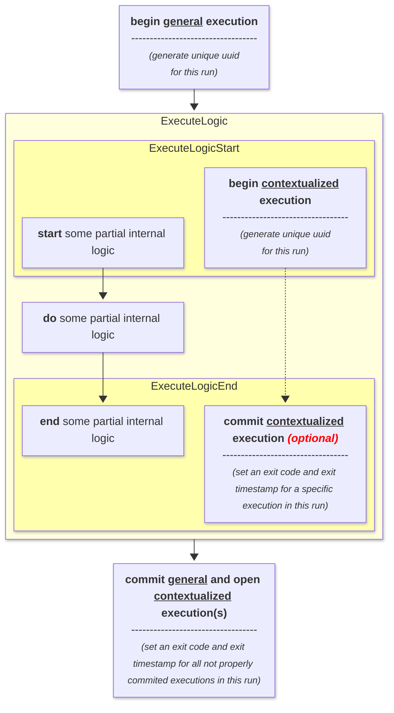

# HBM Basics - Execution Logger

Provides a generic way to log and throttle/debounce console commands.

## Minimal setup

### Command
Your command class must implement interface `ExecutionLoggerCommandInterface`.  
Use the trait `ExecutionLoggerCommandTrait` to provide default/basic functionality.  

Override the abstract methods `getCommandExecution` and `getCommandExecutionRepository`
to provide the entity and entity repository.

```php
<?php

use HBM\BasicsBundle\Command\AbstractExtendableCommand;
use HBM\BasicsBundle\Command\Interfaces\ExecutionLoggerCommandInterface;
use HBM\BasicsBundle\Command\Traits\ExecutionLoggerCommandTrait;
use HBM\BasicsBundle\Entity\AbstractEntity;
use HBM\BasicsBundle\Entity\Interfaces\CommandExecutionInterface;
use HBM\BasicsBundle\Entity\Repository\AbstractServiceEntityRepo;
use Symfony\Component\Console\Command\Command;

abstract class SomeCommand extends AbstractExtendableCommand implements ExecutionLoggerCommandInterface {

  use ExecutionLoggerCommandTrait;
  
  protected function getCommandExecution(): AbstractEntity&CommandExecutionInterface {
    return new CommandExecution($this->getName());
  }

  protected function getCommandExecutionRepository(): ?AbstractServiceEntityRepo {
    // TODO: return CommandExecution repository here.
  }
}
```

### Entity

Create an entity to store the execution that will implement `CommandExecutionInterface`.
You can use the `CommandExecutionTrait` to provide default/basic functionality.

```php
<?php

use HBM\BasicsBundle\Entity\AbstractEntity;
use HBM\BasicsBundle\Entity\Interfaces\CommandExecutionInterface;
use HBM\BasicsBundle\Entity\Traits\CommandExecutionTrait;

class CommandExecution extends AbstractEntity implements CommandExecutionInterface {

  use CommandExecutionTrait;

  public function __construct(string $commandId, array $contexts = [], ?string $executionId = null, ?int $exitCode = null) {
    parent::__construct();
    $this->init($commandId, $contexts, $executionId, $exitCode);
  }
}
```

With the minimal setup, the command execution is only logged, but not throttled/debounced.

## Options
Override `isExecutionLogged` to generally enable/disable the logging.  
Override `getExecutionLimits` to define the execution limits.

### Output/messages
Feel free to override the following properties to adjust the output message **text**...
- `$commandExecutionMessageLimitReached`
- `$commandExecutionMessageLimitReachedInterval`
- `$commandExecutionMessageExecuted`  

... and **verbosity**:
- `$commandExecutionVerbosityLimitReached` (default: `OutputInterface::VERBOSITY_NORMAL`)
- `$commandExecutionVerbosityExecuted` (default: `OutputInterface::VERBOSITY_VERBOSE`)

### Examples:
```txt
WARNING: Command execution limit reached: 2/2 (Interval: PT15M)
1 command execution(s) marked as executed.
```

## Execution limits
You can provide execution limits as an integer or as an array of `CommandExecutionLimit`s.  
A `CommandExecutionLimit` can be restricted by:
- a maximum number
- a time interval and/or
- an exit code _(int for specific exit code, true for any exit code, false for no exit code)_.

### Examples
#### Most basic limit
The command should only be executed once.
```php
protected function getExecutionLimits(): array|int
{
    return 1;
}
```

#### Simple (interval based) execution limit
The command should only be executed once every 15 minutes.
```php
protected function getExecutionLimits(): array|int
{
    return [new CommandExecutionLimit(1, new DateInterval('PT15M'))];
}
```

#### Complex (interval and exit code based) execution limit
The command should only be executed:
- **once every 15 minutes** and 
- a maximum of **four times per day**
- and only **twice with no exit code** (interrupted command)
- and only **once with a failure exit code**.

```php
protected function getExecutionLimits(): array|int
{
    return [
        new CommandExecutionLimit(1, new DateInterval('PT15M')),
        new CommandExecutionLimit(4, new DateInterval('P1D')),
        new CommandExecutionLimit(2, exitCode: false),
        new CommandExecutionLimit(1, exitCode: Symfony\Component\Console\Command\Command::FAILURE),
    ];
}
```


## Contextualized execution
In addition to the general execution limits, you can log contextualized executions.
For example if your console command runs a for-loop, in which you handle a certain
item (e.g. an entity), you can log the execution with the entity context (or any other context).

Start your loop with the following code to 
```php
$commandExecutionLimits = 3;
// or
$commandExecutionLimits = [
    // Consider all commited executions, no matter what exit codes. 
    new CommandExecutionLimit(2, new \DateInterval('PT15M'), true),
    // Consider only unfinished executions with no exit code.
    new CommandExecutionLimit(5, new \DateInterval('PT2H'), false),
    // Consider only executions from a successful run.
    new CommandExecutionLimit(15, new \DateInterval('P1D'), Command::SUCCESS)
];

foreach ($items as $item) {
    foreach ($someOtherOptions as $option) {
        if (!$commandExecution = $this->checkAndLogExecution([$item, $option], $commandExecutionLimits)) {
            continue;
        }
        
        // Do your code.
        
        if ($someThingIsWrong) {
            $this->commitExecution($commandExecution, Command::INVALID);
            continue;
        }
        
        // Exit code will default to Command::SUCCESS.
        $this->commitExecution($commandExecution);
    }
}

```

### Commiting a contextualized execution
Commiting a contextualized execution is done by calling the `commitExecution` method
with the `$commandExecution` object and an optional exit code.

If no exit code is provided, the default exit code is `Command::SUCCESS`.

All non-commited contextualized executions will be commited with the non-erroneous exiting
of the command itself with the same exit timestamp and the exit code returned from the command.

## Process flow


